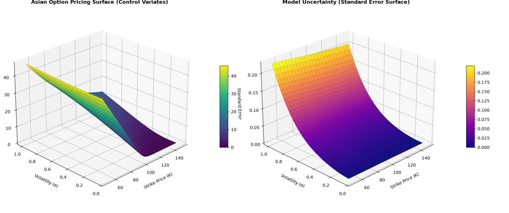

# C++ Options Pricing Engine: Beating Brute-Force Monte Carlo

## About This Project

I am a student exploring the intersection of computer science, applied probability, and quantitative development. I built this project to learn how complex financial derivatives are modeled in code. Coming from a technical background rather than traditional finance, my goal wasn't just to write a pricing formula, but to take a computationally heavy problem and optimize it using statistical engineering and C++.

This project prices **Arithmetic Asian Options**. Because their payoff depends on an average price over time, there is no simple closed-form formula. The standard industry solution is Monte Carlo simulation, but running millions of paths is slow and computationally expensive.

Instead of relying on brute force, I implemented **Variance Reduction Techniques** to achieve high precision with only a fraction of the computational effort.

## The Math & Engineering

To optimize the engine, I implemented two major statistical techniques:

1. **Antithetic Variates (`MonteCarlo.h`):** Instead of generating purely independent random paths, the engine generates mirror pairs. For every random normal draw $Z$, it simultaneously calculates a path using $-Z$. This naturally balances the sample, cancels out symmetric noise, and stabilizes the mean.


2. **Control Variates (`MonteCarlo.h` & `black_scholes.h`):** While the *arithmetic* average has no exact formula, the *geometric* average does. I implemented a discrete-time Geometric Asian exact formula (`GeometricAsianCallPrice`) as a theoretical anchor. The engine simulates both arithmetic and geometric payoffs side-by-side, tracks their covariance, and computes an optimal $\beta^*$ coefficient to mathematically correct the final price.


3. **Defensive C++:** When stress-testing extreme Out-of-the-Money options, simulations can return all zeros, causing sample variance to flatline. I implemented safety guards (e.g., `varGeo > 1e-14`) to prevent division-by-zero (`NaN`) errors, ensuring the engine degrades gracefully to standard Monte Carlo under extreme numerical stress.


## Architecture & Pipeline

I structured the code using clean Object-Oriented principles and separation of concerns:

* **`option.h`**: Base OOP hierarchy defining market parameters and payoff logic for the `AsianOption`.


* **`black_scholes.h`**: Mathematical library containing the CDF function and the analytical benchmark.


* **`MonteCarlo.h`**: The core algorithm calculating the simulation paths, sample moments, and the adjusted standard error.


* **`main.cpp`**: A multi-parameter grid-search driver that tests different maturities, volatilities, and strikes, writing the output directly to `data.csv`.


* **`results.py`**: A Python analytics script using `pandas.pivot_table` and `matplotlib` to aggregate the data and render 3D performance surfaces.


## Results & Visualization

By plotting the `data.csv` output in Python, the theoretical math becomes visible:

* **The Win:** For At-The-Money options, the Control Variates technique slashed the standard error to near zero, proving the mathematical optimization works.
* **The Limit:** The 3D Error Surface vividly shows that at very high volatilities and deep Out-of-the-Money strikes, the linear correlation between the arithmetic and geometric averages breaks down, causing the error to rise—a mathematical limitation correctly captured and handled by the C++ engine.





## What I Learned

Building this pipeline taught me how to:

* Bridge theoretical statistics (covariance, optimal estimators) with functional C++ code.
* Handle floating-point edge cases and numerical stability in intensive simulations.
* Build a complete data pipeline, moving from a compiled high-performance backend (C++) to an analytical frontend (Python/Pandas).

## How to Build and Run

**1. Compile the C++ Engine:**

```bash
# Compile with -O3 optimization for maximum speed
g++ -O3 main.cpp -o engine

# Execute to generate data.csv
./engine

```

**2. Visualize the Data in Python:**

```bash
# Install dependencies
pip install pandas numpy matplotlib

# Generate the 3D research dashboard
python results.py

```